# Relatório: Convolução 2D (stencil)

## 1. Problema resolvido e código-base

### 1.1 Problema

O problema é a aplicação de um filtro de convolução 2D (stencil) de 3×3 sobre uma matriz/imagem
N×N de `float`. A máscara é um blur gaussiano:

```
            | 1 2 1 |
K = 1/16 ×  | 2 4 2 |
            | 1 2 1 |
```

Cada ponto interno da saída é a soma ponderada dos 9 vizinhos da entrada:

```
out[r][c] = Σ (kr = -1..1) Σ (kc = -1..1)  in[r+kr][c+kc] × K[kr+1][kc+1]
```

Cada ponto tem 9 multiplicações e 8 somas (17 FLOP). Só os pontos internos são calculados
(`1 ≤ r, c ≤ N-2`). A borda de 1 elemento não é escrita, porque ela não tem os 8 vizinhos.

### 1.2 Código-base e finalidade

O código-base é um laço C simples, com dois laços sobre a matriz e dois
laços sobre a máscara. A matriz é guardada em um vetor contíguo em ordem por linhas (`in[r * N + c]`).

O código foi criado para este trabalho. A finalidade é ter um kernel pequeno,
com acesso à memória regular e com laços vetorizáveis, para isolar o efeito de cada otimização:

1. ordem de varredura (afinidade de cache);
2. instruções SIMD (vetorização);
3. blocagem (tiling), sozinha e combinada com SIMD;
4. uma biblioteca otimizada (OpenCV).

O mesmo tipo de kernel aparece em processamento de imagens (blur, detecção de bordas) e em
simulações numéricas com diferenças finitas (equação do calor, Jacobi).

Tamanhos testados: N = 1024, 2048 e 4096. O conjunto de dados de entrada é gerado no próprio
programa com valores aleatórios entre 0 e 255 (semente fixa).

## 2. Estrutura do projeto

### 2.1 Divisão em módulos

O projeto tem **um módulo por exercício**. Cada módulo é independente: tem o próprio `Makefile`,
código-fonte, testes, scripts de medição e binários.

| Módulo | Exercício | Linguagem | Binários |
|---|---|---|---|
| `baseline/` | 1. Ordem dos laços, sem vetorização | C11 | `baseline_no_o3`, `baseline_o3` |
| `vectorize/` | 2. Vetorização isolada (linha, sem blocagem) | C11 | `simd_autovec`, `simd_unaligned`, `simd_aligned` |
| `blocking/` | 3. Blocagem isolada e combinada com SIMD | C11 | `blocking_seq`, `blocking_simd` |
| `library/` | 4. OpenCV `cv::filter2D` | C++17 | `library_o3` |

```
conv2D/
├── Makefile                  # encaminha <módulo>-<alvo> para make -C <módulo> <alvo>
├── baseline/ vectorize/ blocking/ library/
│   ├── Makefile              # compila as variantes, testes e assembly
│   ├── src/
│   │   ├── conv/conv2d.c     # kernel da convolução (um arquivo por módulo)
│   │   ├── conv/conv2d.h     # protótipo e máscaras 3×3 (gaussiana, identidade, box)
│   │   └── main.c            # driver: alocação, dados, calibração e medição
│   ├── tests/test_conv.c     # testes de corretude contra a referência escalar
│   ├── scripts/
│   │   ├── <variante>.sh     # laço sobre N (e modo ou B) para cada binário
│   │   └── profile_metrics.py# executa perf + taskset, espera esfriar, grava CSV
│   └── bin/                  # binários gerados (não versionado)
│                             # library/: só conv/conv2d.hpp (máscaras), main.cpp e test_conv.cpp
├── scripts/
│   ├── compile_data.py       # junta os CSVs → all_runs.csv e summary.csv (medianas)
│   ├── analysis/             # common.py, compare.py (tabelas), plot_results.py (gráficos)
│   └── hardware.sh, tools.sh, install_tools.sh
└── docs/
    ├── data/<módulo>/        # um CSV por configuração (10 execuções)
    ├── data/compiled/        # dados consolidados
    └── report/               # este relatório, figuras e notas de metodologia
```

### 2.2 Um fonte, várias variantes (macros `-D`)

As variantes de um exercício **não são cópias do código**. O `Makefile` compila o mesmo `conv2d.c`
várias vezes, com flags e macros diferentes:

| Módulo | Macro | Efeito no kernel |
|---|---|---|
| `baseline` | — | Duas funções no mesmo arquivo (`conv2d_row_major` e `conv2d_col_major`). O argumento `mode` escolhe uma delas por ponteiro de função. |
| `vectorize` | (nenhuma) | Laço simples: autovetorização do compilador. |
| `vectorize` | `-DMODE_UNALIGNED` | `#pragma omp simd` no laço interno. |
| `vectorize` | `-DMODE_ALIGNED` | `#pragma omp simd aligned(input, output: 32)` + `__restrict__`; o `main.c` usa `aligned_alloc(32, ...)`. |
| `blocking` | (nenhuma) | Tiling com 4 laços, `-fno-tree-vectorize`. |
| `blocking` | `-DMODE_SIMD` | Tiling + `#pragma omp simd aligned(...)` + `__restrict__` no laço interno. |

Assim, a única diferença entre duas variantes é a otimização estudada. Isso isola o efeito de cada técnica.

### 2.3 Estruturas principais do código

**Kernel** (`src/conv/conv2d.c`). A matriz é um vetor contíguo `float[N*N]`, acessado como `in[r * N + c]`:

```c
void conv2d_row_major(const float *input, float *output, int N, const float kernel[3][3]); // baseline
void conv2d_col_major(const float *input, float *output, int N, const float kernel[3][3]); // baseline
void conv2d(const float *input, float *output, int N, const float kernel[3][3]);           // vectorize
void conv2d(const float *input, float *output, int N, const float kernel[3][3], int B);    // blocking
```

**Driver** (`src/main.c`, ou `main.cpp` no OpenCV). Todos os módulos usam a mesma estrutura de medição:

```c
#define TARGET_TIME_S 1.0                         // duração mínima do laço medido
#define RAPL_DIR "/sys/class/powercap/intel-rapl:0"

typedef struct {
    double time_s;                                // tempo total do laço
    double energy_j;                              // energia total do laço (-1 se o RAPL não puder ser lido)
} measure_t;

static inline double func_time(...);              // tempo de 1 chamada (para calibrar reps)
static inline void perf_control(const char *cmd); // "enable"/"disable" na FIFO do perf
static inline long long rapl_read_uj(void);       // lê energy_uj do RAPL
static inline measure_t func_energy(..., int reps); // perf + RAPL + relógio em volta do laço × reps
```

**Contrato da linha de comando.** O `profile_metrics.py` depende destes argumentos e da linha de saída:

| Binário | Argumentos |
|---|---|
| `baseline_*` | `<N> <mode>` (0 = linha, 1 = coluna) |
| `simd_*`, `library_o3` | `<N>` |
| `blocking_*` | `<N> <B>` |

```
JSON_METRICS:{"kernel_time_s": ..., "reps": ..., "total_time_s": ..., "energy_j": ...}
```

### 2.4 Fluxo de dados

```
<módulo>/scripts/<variante>.sh      laço sobre N = 1024, 2048, 4096 (e modo ou B)
        │
        ▼
profile_metrics.py                  10 execuções: espera ≤ 60 °C → perf stat + taskset -c 2 → binário
        │                           lê JSON_METRICS e os contadores, divide por reps
        ▼
docs/data/<módulo>/*.csv            um CSV por configuração (48 configurações)
        │
        ▼
scripts/compile_data.py             all_runs.csv + summary.csv (média, desvio, mediana)
        │
        ▼
scripts/analysis/                   compare.py → resume.md; plot_results.py → figures/
```

### 2.5 Comandos principais

```bash
make build | test | run | clean      # todos os módulos
```

## 3. Equipamento e ferramentas

| Item | Valor |
|---|---|
| CPU | Intel Core i5-12500H (Alder Lake, híbrida) |
| Núcleos | 4 P-cores (CPUs 0–7, com HT) + 8 E-cores (CPUs 8–15) |
| Frequência máxima | 4,5 GHz (P-core) |
| Cache L1d | 48 KiB por P-core (32 KiB por E-core) |
| Cache L2 | 1,25 MiB por P-core (2 MiB compartilhado por grupo de 4 E-cores) |
| Cache L3 (LLC) | 18 MiB compartilhado |
| Memória | 15 GiB |
| Instruções vetoriais | SSE4.2, AVX, AVX2, FMA, AVX-VNNI. **Sem AVX-512** |
| Sistema | Fedora 43, kernel Linux 7.0.12 |
| Perfil de energia | ACPI `platform_profile` = `performance` |
| Compiladores | gcc / g++ 15.2.1 |
| Biblioteca | OpenCV 4.11.0 (pacote Fedora: framework TBB, sem Intel IPP) |
| Contadores | `perf` 7.2.9 (`perf stat`) |
| Energia | Intel RAPL pela interface powercap (`/sys/class/powercap/intel-rapl:0/energy_uj`, domínio *package*) |

## 4. Metodologia de medição

### 4.1 Ferramentas e eventos

| Ferramenta | Uso |
|---|---|
| `perf stat` | `cycles`, `instructions`, misses L1d (`L1-dcache-load-misses`), misses L2 (`l2_rqsts.miss`) e misses LLC (`LLC-load-misses`). CPI = cycles ÷ instructions. |
| RAPL (powercap) | Energia do pacote da CPU em µJ, lida pelo próprio binário. |
| `clock_gettime` (C) / `std::chrono` (C++) | Tempo do laço medido. |

### 4.2 Como cada execução é medida

Tempo, energia e contadores cobrem **o mesmo intervalo**: somente o laço do kernel.

```
[ início | alocação | dados aleatórios | 1 chamada sem medição | calibração | KERNEL × reps | fim ]
                                                                            ▲               ▲
                                                 perf liga, lê RAPL, relógio┘               └ relógio, lê RAPL, perf desliga
```

1. **Chamada sem medição.** Ela paga os *page faults* da primeira escrita em `output` e aquece as caches.
2. **Calibração.** O programa mede uma chamada e calcula `reps = 1 s ÷ tempo de 1 chamada + 1`.
3. **Laço medido de ≈ 1 s.** O RAPL atualiza a cada ≈ 1 ms. Uma chamada de 0,25 ms não pode ser medida
   sozinha.
4. **Contadores só no laço.** O `perf stat -D -1 --control fifo:...` começa desligado. O binário liga e
   desliga os contadores por uma FIFO, imediatamente antes e depois do laço.
5. **Valores por chamada.** Energia e contadores são divididos por `reps`. A potência é a média real
   do laço (energia do laço ÷ tempo do laço).
6. **Núcleo fixo.** Todas as execuções usam `taskset -c 2` (um P-core). Sem isso, um processo que passa
   pouco tempo em um E-core recebe contagens *estimadas* do `perf`. Em um teste, isso aumentou as
   instruções de 35,5 M para até 58 M por chamada.
7. **Mesma temperatura inicial.** Antes de cada execução, o script espera o sensor `x86_pkg_temp`
   ficar ≤ 60 °C (no máximo 60 s). A temperatura inicial fica no CSV.
8. **Repetições.** 10 execuções (processos separados) por configuração. As tabelas usam a **mediana**.

Todas as versões rodam em **uma thread**, no mesmo P-core, inclusive o OpenCV (`cv::setNumThreads(1)`;
ver seção 8.4).

### 4.3 Fórmulas (por chamada do kernel)

- MFLOPS = (N − 2)² × 17 ÷ (10⁶ × tempo)
- CPI = cycles ÷ instructions
- Potência (W) = energia do laço ÷ tempo do laço
- Energia (J) = energia do laço ÷ reps
- Eficiência = MFLOPS ÷ W (MFLOPS/W). Como W = J/s, MFLOPS/W também é igual a milhões de FLOP por joule.

### 4.4 Qualidade dos dados

| Verificação | Resultado |
|---|---|
| Configurações | 48, cada uma com 10 execuções válidas |
| Temperatura inicial | 41–60 °C; nenhuma execução começou acima de 60 °C |
| Potência | 26–36 W em todas as configurações |
| Frequência (cycles ÷ tempo) | 4,45–4,48 GHz no código escalar; 4,37–4,40 GHz no código AVX2 |
| Instruções por chamada | Variação < 0,1 % entre execuções (processo sempre no mesmo P-core) |

## 5. Versões, pragmas e alterações

Cada módulo tem **um único arquivo-fonte** do kernel. As variantes são geradas pelo `Makefile` com
flags diferentes e macros `-D`. O corpo do laço é o mesmo em todas as versões.

| Versão | Módulo | Flags | Alteração em relação à anterior |
|---|---|---|---|
| Base -O0 (linha/coluna) | `baseline` | `-Wall -fno-tree-vectorize` | Referência, sem otimização. |
| Base -O3 (linha/coluna) | `baseline` | `-O3 -Wall -fno-tree-vectorize` | Otimização do compilador, **sem SIMD**. |
| SIMD autovetorização | `vectorize` | `-O3 -mavx2 -mfma` | O compilador vetoriza sozinho. Sem pragma. |
| SIMD pragma | `vectorize` | `+ -fopenmp-simd -DMODE_UNALIGNED` | `#pragma omp simd` no laço `c`. |
| SIMD pragma + aligned | `vectorize` | `+ -fopenmp-simd -DMODE_ALIGNED` | `#pragma omp simd aligned(input, output: 32)`, `__restrict__` nos ponteiros e `aligned_alloc(32, ...)`. |
| Tiling | `blocking` | `-O3 -fno-tree-vectorize` | 4 laços (`ii`, `jj`, `r`, `c`), B = 8, 16, 32, 64. |
| Tiling + SIMD | `blocking` | `-O3 -mavx2 -mfma -fopenmp-simd -DMODE_SIMD` | Tiling + `__restrict__` + `#pragma omp simd aligned(input, output: 32)` no laço `c`. |
| OpenCV | `library` | `-O3`, `pkg-config opencv4` | O laço é trocado por `cv::filter2D`. |

Principais alterações no código:

```diff
 // Base (linha): acesso contíguo
 for (int r = 1; r < N - 1; r++)
     for (int c = 1; c < N - 1; c++) { ... }

 // Coluna: laços trocados, acesso com passo N
-for (int r ...) for (int c ...)
+for (int c ...) for (int r ...)

 // SIMD pragma + aligned
+void conv2d(const float *__restrict__ input, float *__restrict__ output, ...)
 for (int r = 1; r < N - 1; r++) {
+#pragma omp simd aligned(input, output: 32)
     for (int c = 1; c < N - 1; c++) { ... }
 }

 // Tiling (blocagem)
+#define MIN(a, b) (((a) < (b)) ? (a) : (b))
+for (int ii = 1; ii < N - 1; ii += B)
+  for (int jj = 1; jj < N - 1; jj += B)
-for (int r = 1; r < N - 1; r++)
-  for (int c = 1; c < N - 1; c++)
+     for (int r = ii; r < MIN(ii + B, N - 1); r++)
+       for (int c = jj; c < MIN(jj + B, N - 1); c++)

 // OpenCV
+cv::setNumThreads(1);
+cv::filter2D(input, output, -1, GAUSSIAN_KERNEL);
```

## 6. Corretude nos limites das bordas

O enunciado pede para mostrar que não há acesso fora da matriz para qualquer tamanho de bloco e de imagem.

**Argumento pelos índices.** Os laços de saída cobrem `1 ≤ r ≤ N-2` e `1 ≤ c ≤ N-2`. A máscara soma
`kr, kc ∈ {-1, 0, 1}`. Então as leituras ficam em `0 ≤ r+kr ≤ N-1` e `0 ≤ c+kc ≤ N-1`, sempre dentro da
matriz. No tiling, o fim de cada bloco é `MIN(ii + B, N - 1)` e `MIN(jj + B, N - 1)`. O último bloco é
cortado em N-1 quando N-2 não é múltiplo de B, e também quando B > N-2.

**Testes automáticos** (`make test`). Cada versão é comparada com uma referência escalar
(tolerância `1e-4`, porque o FMA muda o arredondamento) para N = 64, **N = 65 (ímpar)** e N = 1024. O tiling é
testado com B = 8, 16, 32 e 64. N = 65 deixa 63 colunas internas: isso testa a cauda do laço SIMD
(63 = 7×8 + 7) e o bloco parcial do tiling.

**Teste com páginas de guarda.** Cada matriz foi alocada encostada em uma página de memória protegida
(`mprotect(PROT_NONE)`), uma vez no início e outra vez no fim da página. Qualquer leitura ou escrita fora
da matriz gera falha de segmentação. Também foi verificado que a borda da saída não é escrita e que os
pontos internos são iguais à referência.

## 7. Resultados

Valores por chamada do kernel, mediana de 10 execuções.

### 7.1 Exercício 1 — ordem dos laços (sem vetorização)

**N = 1024**

| Versão | Tempo (ms) | MFLOPS | CPI | Misses L1 | Misses L2 | Misses LLC | Potência (W) | Energia (J) | MFLOPS/W |
|---|---:|---:|---:|---:|---:|---:|---:|---:|---:|
| -O0 linha | 15,794 | 1.124 | 0,193 | 10,7 k | 168,5 k | 95 | 32,0 | 0,5091 | 35 |
| -O0 coluna | 23,744 | 748 | 0,291 | 1,08 M | 9,09 M | 10,4 k | 32,1 | 0,7657 | 23 |
| -O3 linha | 1,891 | 9.392 | 0,238 | 6,66 k | 134,9 k | 16 | 29,7 | 0,0557 | 319 |
| -O3 coluna | 5,167 | 3.437 | 0,670 | 873,7 k | 2,46 M | 3,30 k | 29,7 | 0,1530 | 116 |

**N = 2048**

| Versão | Tempo (ms) | MFLOPS | CPI | Misses L1 | Misses L2 | Misses LLC | Potência (W) | Energia (J) | MFLOPS/W |
|---|---:|---:|---:|---:|---:|---:|---:|---:|---:|
| -O0 linha | 63,095 | 1.128 | 0,193 | 49,5 k | 943,7 k | 720 | 32,4 | 2,0480 | 35 |
| -O0 coluna | 138,551 | 514 | 0,424 | 6,52 M | 34,7 M | 587,6 k | 29,4 | 4,0831 | 17 |
| -O3 linha | 7,788 | 9.138 | 0,244 | 44,3 k | 933,8 k | 486 | 29,9 | 0,2339 | 304 |
| -O3 coluna | 44,510 | 1.599 | 1,437 | 5,93 M | 15,5 M | 708,5 k | 28,0 | 1,2408 | 57 |

**N = 4096**

| Versão | Tempo (ms) | MFLOPS | CPI | Misses L1 | Misses L2 | Misses LLC | Potência (W) | Energia (J) | MFLOPS/W |
|---|---:|---:|---:|---:|---:|---:|---:|---:|---:|
| -O0 linha | 253,600 | 1.124 | 0,194 | 284,5 k | 3,79 M | 2,61 k | 32,5 | 8,2686 | 34 |
| -O0 coluna | 1.021,920 | 279 | 0,781 | 34,5 M | 135,9 M | 11,2 M | 26,0 | 26,5737 | 11 |
| -O3 linha | 31,464 | 9.057 | 0,247 | 262,1 k | 3,74 M | 1,84 k | 30,1 | 0,9709 | 294 |
| -O3 coluna | 338,171 | 843 | 2,723 | 33,0 M | 79,1 M | 12,3 M | 26,2 | 8,8619 | 32 |

### 7.2 Exercício 2 — vetorização isolada (linha, sem blocagem)

**N = 1024**

| Versão | Tempo (ms) | MFLOPS | CPI | Misses L1 | Misses L2 | Misses LLC | Potência (W) | Energia (J) | MFLOPS/W |
|---|---:|---:|---:|---:|---:|---:|---:|---:|---:|
| -O3 linha (sem SIMD) | 1,891 | 9.392 | 0,238 | 6,66 k | 134,9 k | 16 | 29,7 | 0,0557 | 319 |
| SIMD autovetorização | 0,250 | 71.130 | 0,540 | 8,40 k | 131,7 k | 14 | 32,9 | 0,0083 | 2.148 |
| SIMD pragma | 0,303 | 58.568 | 0,439 | 3,65 k | 131,7 k | 5 | 33,1 | 0,0100 | 1.781 |
| SIMD pragma + aligned + restrict | 0,248 | 71.670 | 0,551 | 25,5 k | 131,7 k | 26 | 32,6 | 0,0081 | 2.196 |

**N = 2048**

| Versão | Tempo (ms) | MFLOPS | CPI | Misses L1 | Misses L2 | Misses LLC | Potência (W) | Energia (J) | MFLOPS/W |
|---|---:|---:|---:|---:|---:|---:|---:|---:|---:|
| -O3 linha (sem SIMD) | 7,788 | 9.138 | 0,244 | 44,3 k | 933,8 k | 486 | 29,9 | 0,2339 | 304 |
| SIMD autovetorização | 1,538 | 46.287 | 0,871 | 101,3 k | 922,7 k | 13,0 k | 32,9 | 0,0500 | 1.423 |
| SIMD pragma | 1,673 | 42.531 | 0,625 | 134,3 k | 923,7 k | 13,2 k | 33,4 | 0,0562 | 1.265 |
| SIMD pragma + aligned + restrict | 1,473 | 48.312 | 0,846 | 109,1 k | 926,6 k | 16,8 k | 33,2 | 0,0491 | 1.450 |

**N = 4096**

| Versão | Tempo (ms) | MFLOPS | CPI | Misses L1 | Misses L2 | Misses LLC | Potência (W) | Energia (J) | MFLOPS/W |
|---|---:|---:|---:|---:|---:|---:|---:|---:|---:|
| -O3 linha (sem SIMD) | 31,464 | 9.057 | 0,247 | 262,1 k | 3,74 M | 1,84 k | 30,1 | 0,9709 | 294 |
| SIMD autovetorização | 6,920 | 41.177 | 1,008 | 1,07 M | 3,70 M | 74,1 k | 33,1 | 0,2293 | 1.243 |
| SIMD pragma | 7,438 | 38.307 | 0,697 | 1,07 M | 3,71 M | 52,7 k | 33,5 | 0,2467 | 1.155 |
| SIMD pragma + aligned + restrict | 6,758 | 42.165 | 0,989 | 1,02 M | 3,71 M | 82,8 k | 33,1 | 0,2237 | 1.274 |

### 7.3 Exercício 3 — blocagem isolada e combinada

**N = 1024**

| Versão | Tempo (ms) | MFLOPS | CPI | Misses L1 | Misses L2 | Misses LLC | Potência (W) | Energia (J) | MFLOPS/W |
|---|---:|---:|---:|---:|---:|---:|---:|---:|---:|
| Tiling B=8 | 1,927 | 9.213 | 0,254 | 148,6 k | 134,4 k | 26 | 30,1 | 0,0579 | 307 |
| Tiling B=16 | 1,908 | 9.307 | 0,258 | 86,1 k | 136,3 k | 32 | 30,2 | 0,0579 | 307 |
| Tiling B=32 | 1,880 | 9.443 | 0,257 | 48,6 k | 142,1 k | 36 | 29,9 | 0,0562 | 316 |
| Tiling B=64 | 1,903 | 9.328 | 0,262 | 24,4 k | 152,3 k | 54 | 29,4 | 0,0561 | 317 |
| Tiling+SIMD B=8 | 0,906 | 19.589 | 0,358 | 110,3 k | 136,4 k | 18 | 31,0 | 0,0282 | 629 |
| Tiling+SIMD B=16 | 0,565 | 31.426 | 0,389 | 135,2 k | 134,9 k | 18 | 32,6 | 0,0184 | 964 |
| Tiling+SIMD B=32 | 0,400 | 44.360 | 0,426 | 88,7 k | 141,0 k | 20 | 32,6 | 0,0131 | 1.355 |
| Tiling+SIMD B=64 | 0,348 | 51.064 | 0,507 | 52,0 k | 150,5 k | 52 | 33,1 | 0,0115 | 1.546 |

**N = 2048**

| Versão | Tempo (ms) | MFLOPS | CPI | Misses L1 | Misses L2 | Misses LLC | Potência (W) | Energia (J) | MFLOPS/W |
|---|---:|---:|---:|---:|---:|---:|---:|---:|---:|
| Tiling B=8 | 7,921 | 8.985 | 0,261 | 687,9 k | 897,7 k | 2,18 k | 30,8 | 0,2436 | 292 |
| Tiling B=16 | 7,818 | 9.103 | 0,264 | 365,5 k | 915,2 k | 1,94 k | 31,1 | 0,2431 | 293 |
| Tiling B=32 | 7,718 | 9.220 | 0,263 | 182,7 k | 977,2 k | 1,60 k | 30,8 | 0,2373 | 300 |
| Tiling B=64 | 8,334 | 8.556 | 0,286 | 115,0 k | 741,0 k | 4,09 k | 29,6 | 0,2486 | 286 |
| Tiling+SIMD B=8 | 3,794 | 18.762 | 0,375 | 589,4 k | 924,4 k | 1,22 k | 31,9 | 0,1213 | 587 |
| Tiling+SIMD B=16 | 2,480 | 28.693 | 0,430 | 557,5 k | 925,5 k | 3,34 k | 33,7 | 0,0836 | 851 |
| Tiling+SIMD B=32 | 1,774 | 40.104 | 0,478 | 350,7 k | 965,3 k | 3,38 k | 35,5 | 0,0633 | 1.125 |
| Tiling+SIMD B=64 | 2,673 | 26.622 | 0,987 | 218,5 k | 654,9 k | 23,3 k | 30,0 | 0,0808 | 880 |

**N = 4096**

| Versão | Tempo (ms) | MFLOPS | CPI | Misses L1 | Misses L2 | Misses LLC | Potência (W) | Energia (J) | MFLOPS/W |
|---|---:|---:|---:|---:|---:|---:|---:|---:|---:|
| Tiling B=8 | 31,256 | 9.116 | 0,257 | 2,42 M | 3,62 M | 4,75 k | 30,9 | 0,9653 | 295 |
| Tiling B=16 | 30,936 | 9.210 | 0,260 | 1,33 M | 3,76 M | 4,44 k | 31,3 | 0,9668 | 295 |
| Tiling B=32 | 30,734 | 9.271 | 0,262 | 786,9 k | 4,06 M | 6,61 k | 30,8 | 0,9539 | 299 |
| Tiling B=64 | 32,874 | 8.671 | 0,282 | 504,1 k | 2,66 M | 45,5 k | 30,3 | 0,9976 | 286 |
| Tiling+SIMD B=8 | 15,729 | 18.116 | 0,391 | 2,61 M | 3,66 M | 9,18 k | 32,0 | 0,5067 | 562 |
| Tiling+SIMD B=16 | 11,082 | 25.712 | 0,482 | 2,31 M | 3,60 M | 19,7 k | 33,0 | 0,3646 | 781 |
| Tiling+SIMD B=32 | 8,269 | 34.457 | 0,560 | 1,50 M | 3,90 M | 22,7 k | 34,4 | 0,2846 | 1.001 |
| Tiling+SIMD B=64 | 12,030 | 23.687 | 1,120 | 880,2 k | 3,41 M | 148,1 k | 30,4 | 0,3662 | 778 |

### 7.4 Exercício 4 — OpenCV × versões próprias

**N = 1024**

| Versão | Tempo (ms) | MFLOPS | CPI | Misses L1 | Misses L2 | Misses LLC | Potência (W) | Energia (J) | MFLOPS/W |
|---|---:|---:|---:|---:|---:|---:|---:|---:|---:|
| SIMD pragma + aligned + restrict | 0,248 | 71.670 | 0,551 | 25,5 k | 131,7 k | 26 | 32,6 | 0,0081 | 2.196 |
| Tiling+SIMD B=32 | 0,400 | 44.360 | 0,426 | 88,7 k | 141,0 k | 20 | 32,6 | 0,0131 | 1.355 |
| OpenCV filter2D | 0,337 | 52.755 | 0,405 | 31,2 k | 134,0 k | 200 | 33,9 | 0,0115 | 1.551 |

**N = 2048**

| Versão | Tempo (ms) | MFLOPS | CPI | Misses L1 | Misses L2 | Misses LLC | Potência (W) | Energia (J) | MFLOPS/W |
|---|---:|---:|---:|---:|---:|---:|---:|---:|---:|
| SIMD pragma + aligned + restrict | 1,473 | 48.312 | 0,846 | 109,1 k | 926,6 k | 16,8 k | 33,2 | 0,0491 | 1.450 |
| Tiling+SIMD B=32 | 1,774 | 40.104 | 0,478 | 350,7 k | 965,3 k | 3,38 k | 35,5 | 0,0633 | 1.125 |
| OpenCV filter2D | 1,884 | 37.767 | 0,601 | 315,5 k | 922,6 k | 113,4 k | 34,9 | 0,0661 | 1.076 |

**N = 4096**

| Versão | Tempo (ms) | MFLOPS | CPI | Misses L1 | Misses L2 | Misses LLC | Potência (W) | Energia (J) | MFLOPS/W |
|---|---:|---:|---:|---:|---:|---:|---:|---:|---:|
| SIMD pragma + aligned + restrict | 6,758 | 42.165 | 0,989 | 1,02 M | 3,71 M | 82,8 k | 33,1 | 0,2237 | 1.274 |
| Tiling+SIMD B=32 | 8,269 | 34.457 | 0,560 | 1,50 M | 3,90 M | 22,7 k | 34,4 | 0,2846 | 1.001 |
| OpenCV filter2D | 8,744 | 32.586 | 0,732 | 1,55 M | 3,77 M | 635,2 k | 34,0 | 0,2991 | 953 |

### 7.5 Gráficos

Os rótulos "best B" usam o melhor bloco de cada N. O valor de B está escrito acima da barra.

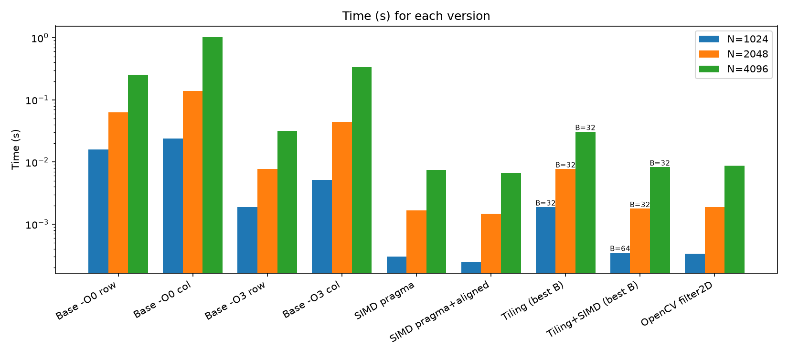
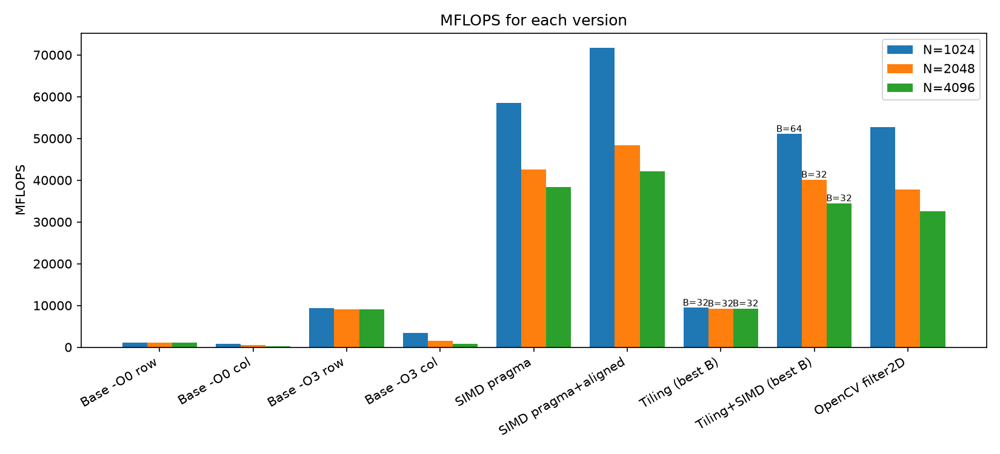
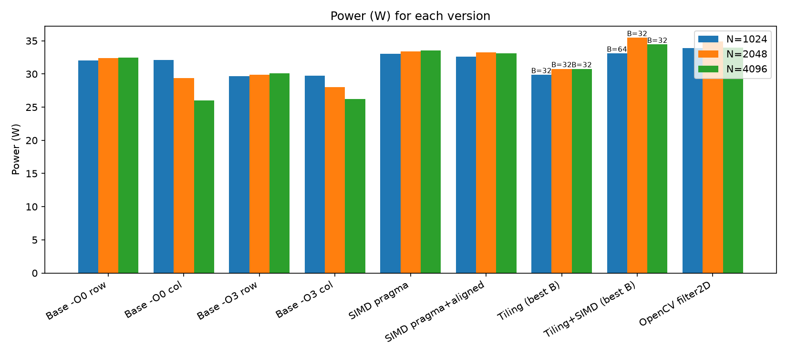
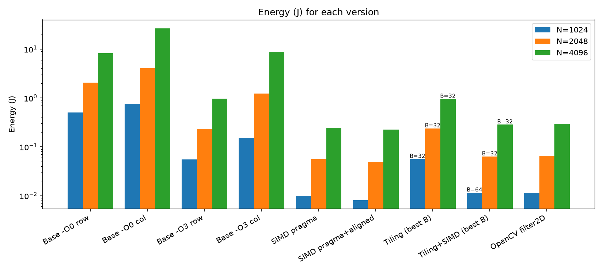
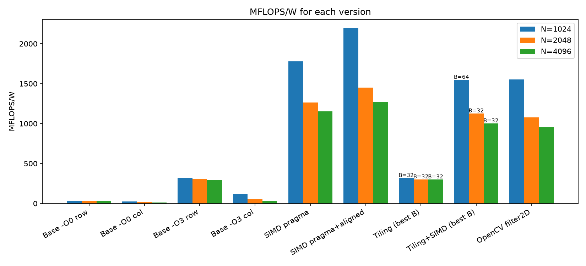
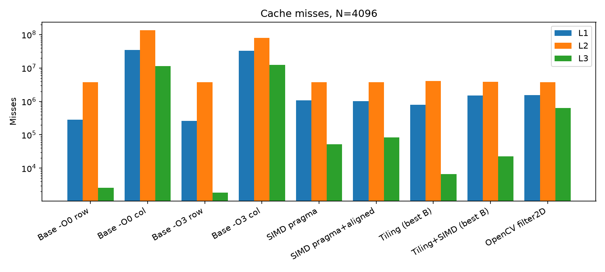

Blocagem, para cada B:

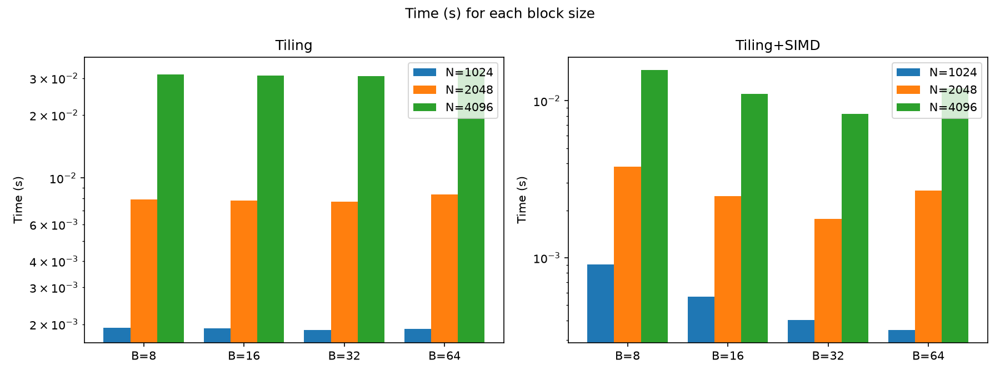
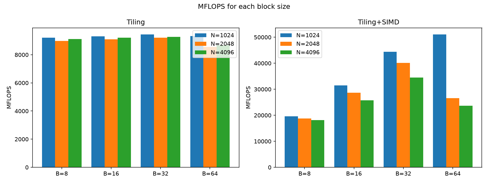
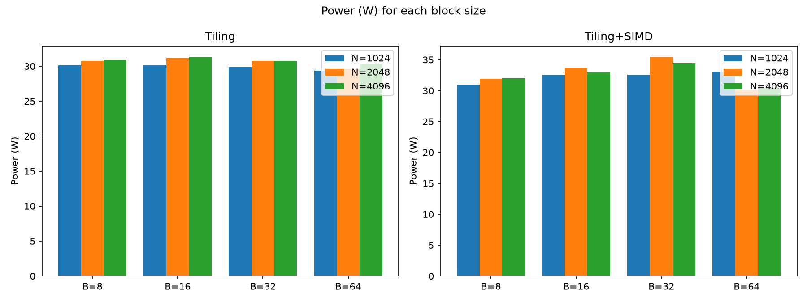
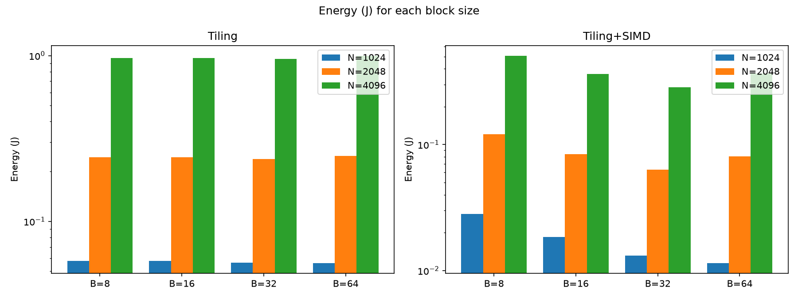
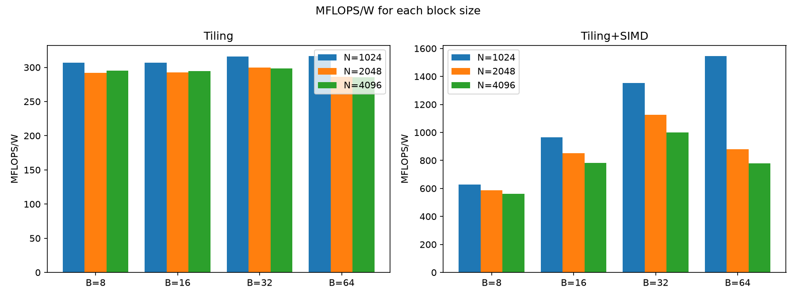
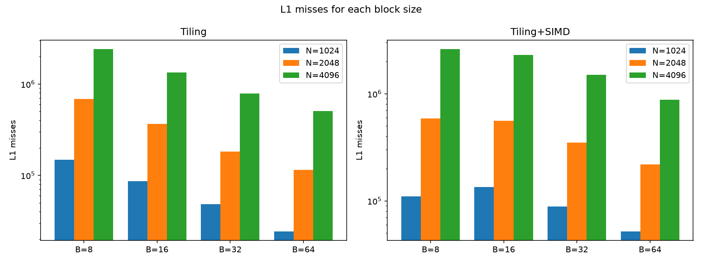

## 8. Análise comparativa

### 8.1 Afinidade de cache (Exercício 1)

**A varredura por linhas é a mais eficiente** em todos os tamanhos, em tempo, energia e misses.

| -O3, sem SIMD | N = 1024 | N = 2048 | N = 4096 |
|---|---:|---:|---:|
| Tempo coluna ÷ linha | 2,7× | 5,7× | 10,7× |
| Energia coluna ÷ linha | 2,7× | 5,3× | 9,1× |
| CPI linha → coluna | 0,24 → 0,67 | 0,24 → 1,44 | 0,25 → 2,72 |

- Na linha, o laço interno lê endereços contíguos. Cada linha de cache de 64 bytes traz 16 `float`
  que são usados em seguida (localidade espacial), e o *prefetcher* de hardware prevê o próximo acesso.
- Na coluna, o laço interno pula N `float` a cada iteração. Cada acesso usa 4 bytes de uma linha
  de 64 bytes. Em N = 4096, os misses de L1 aumentam 126× e os misses de LLC aumentam ≈ 6700×
  (1,8 k → 12,3 M por chamada).
- **O efeito cresce com N.** Em N = 1024, as duas matrizes (2 × 4 MB = 8 MB) cabem no L3 de 18 MB:
  os misses de L1/L2 da coluna são servidos pelo L3 e a diferença é 2,7×. Em N = 2048 (32 MB) e
  N = 4096 (128 MB), os dados não cabem no L3 e a coluna vai à DRAM.
- **Potência × energia.** A coluna usa *menos* potência (26 W contra 30 W em N = 4096), porque o núcleo
  fica parado esperando a memória. Mas ela demora 10,7× mais, então gasta 9,1× mais energia.
  **Menor potência não significa menor energia.**
- Com -O0, a diferença é menor (4,0× em N = 4096), porque o código sem otimização executa 10× mais
  instruções, e o custo das instruções esconde parte do custo da memória.
- A otimização -O3 sozinha dá ≈ 8× em relação a -O0 (linha): menos instruções (5,85 G → 0,57 G por
  chamada em N = 4096) com a mesma frequência.

### 8.2 Vetorização isolada (Exercício 2)

A vetorização usa AVX2 (8 `float` por instrução) e FMA. A ordem por linha foi mantida, sem blocagem.

| SIMD pragma + aligned ÷ -O3 linha | N = 1024 | N = 2048 | N = 4096 |
|---|---:|---:|---:|
| Speedup em tempo | 7,6× | 5,3× | 4,7× |
| Potência | +10 % | +11 % | +10 % |
| Ganho em MFLOPS/W | 6,9× | 4,8× | 4,3× |
| Energia por chamada | −85 % | −79 % | −77 % |

- **A potência sobe pouco (≈ 30 → 33 W) e o tempo cai muito.** Por isso a energia cai 77–85 %.
  A frequência medida cai um pouco com AVX2 (4,48 → 4,38 GHz), o que é normal nas CPUs Intel.
- **A CPI sobe com SIMD** (0,25 → 0,99 em N = 4096), mas as instruções caem 19× (570 M → 30 M).
  Cada instrução faz 8 operações. Por isso, a CPI sozinha não indica desempenho entre código escalar e
  vetorial.
- **O ganho cai quando N cresce** (7,6× → 4,7×). Em N = 1024 os dados estão no L3. Em N = 4096 o código
  vetorial lê 64 MB e escreve 64 MB por chamada em 6,8 ms (≈ 19–28 GB/s, com a leitura para escrita).
  O limite passa a ser a banda de memória, e não mais o cálculo. Os misses de LLC sobem de 1,8 k para
  ≈ 80 k por chamada.

**Efeito de cada pragma** (análise do assembly gerado; detalhes em `../methodology_notes.md`, seção 6):

| Variante | Laço interno (8 floats) | N = 4096 |
|---|---|---:|
| Autovetorização (sem pragma) | 9 `vfmadd` + 1 `vmovups`; pesos em registradores | 6,920 ms |
| `#pragma omp simd` | 9 `vfmadd` + **8 `vbroadcastss`** + 1 `vmovups` | 7,438 ms |
| `#pragma omp simd aligned` + `__restrict__` | 9 `vfmadd` + 1 `vmovups` | 6,758 ms |

- Com `#pragma omp simd` sem `__restrict__`, o compilador não pode provar que `output` não sobrepõe a
  máscara. Ele relê os pesos a cada iteração (+55 % de instruções). Por isso, o pragma sozinho foi
  **mais lento** que a autovetorização.
- O ganho de "aligned" vem do `__restrict__`, e não do alinhamento. Os acessos começam em `c = 1`
  (e usam `c-1` e `c+1`), então os endereços não são múltiplos de 32 bytes, e o compilador continua com
  `vmovups`. Em um teste separado, a versão só com `__restrict__` teve o mesmo desempenho.
- Em N = 1024, as versões SIMD têm duas velocidades entre execuções (coeficiente de variação de 19–47 %;
  ver seção 9). A mediana fica no grupo rápido nas três versões.

### 8.3 Blocagem isolada e combinada (Exercício 3)

**a) Tiling sem SIMD.** Com B ≤ 32, o tamanho de bloco quase não muda o resultado: diferença de −2 % a +2 %
em relação a -O3 linha. **B = 32 é o melhor** nos três tamanhos, com ganho máximo de 2,3 % em tempo e
1,8 % em energia (N = 4096).

- O stencil 3×3 por linha já tem boa localidade temporal: cada linha de entrada é usada em 3 linhas
  de saída seguidas. Três linhas de 4096 `float` ocupam 48 KB: isso fica perto do L1d (48 KB) e cabe
  com folga no L2 (1,25 MB). O tiling não traz reuso novo.
- Blocos maiores reduzem os misses de L1 (N = 4096: 2,42 M com B = 8 → 0,50 M com B = 64), mas o
  tempo não cai, porque esses misses já eram servidos pelo L2.
- B = 64 piora em N = 2048 e 4096: o tempo sobe 7–8 % em relação a B = 32, e os misses de LLC sobem
  2,6× (N = 2048) e 6,9× (N = 4096). Uma faixa de B
  linhas de entrada e saída ocupa (2B + 2) × N × 4 bytes. Em N = 4096: 1,0 MB com B = 32 e 2,1 MB com
  B = 64, que não cabe no L2 de 1,25 MB.

**b) Tiling + SIMD.** O melhor bloco é B = 32 em N = 2048 e 4096, e B = 64 em N = 1024.

| N = 4096 | Tempo (ms) | Instruções | Potência (W) | Energia (J) | MFLOPS/W |
|---|---:|---:|---:|---:|---:|
| -O3 linha | 31,464 | 570 M | 30,1 | 0,971 | 294 |
| Tiling B = 32 | 30,734 | 525 M | 30,8 | 0,954 | 299 |
| SIMD pragma + aligned | 6,758 | 30 M | 33,1 | 0,224 | 1.274 |
| Tiling + SIMD B = 32 | 8,269 | 64 M | 34,4 | 0,285 | 1.001 |

- Em relação ao tiling e à base escalar, a versão combinada é 3,8× mais rápida, usa ≈ 70 % menos
  energia e tem 3,4× mais MFLOPS/W.
- **Mas a versão combinada é pior que o SIMD sem blocagem**: +22 % de tempo, +27 % de energia,
  +4 % de potência e −21 % de MFLOPS/W em N = 4096. O tempo também é maior em N = 1024 (+40 %) e
  N = 2048 (+20 %).
- Causa: a versão combinada executa **2,1× mais instruções** (64 M contra 30 M). O laço SIMD interno
  tem só B iterações (B = 32 → 4 vetores de 8). Cada linha de bloco repete o início do laço, o
  prólogo e a cauda. Blocos menores pioram isso: B = 8 executa 177 M instruções.
- B = 64 reduz as instruções (47 M), mas aumenta os misses de LLC (22,7 k → 148 k). O núcleo espera a
  memória: a potência cai para 30 W e o tempo sobe para 12,0 ms.

**Conclusão:** para este stencil, a blocagem não compensa. O ganho vem da ordem por linha e da
vetorização.

### 8.4 Biblioteca otimizada — OpenCV (Exercício 4)

`cv::filter2D` foi usado com as otimizações automáticas da biblioteca (despacho SIMD em tempo de
execução até AVX2), em uma thread no mesmo P-core.

| OpenCV ÷ melhor versão própria | N = 1024 | N = 2048 | N = 4096 |
|---|---:|---:|---:|
| Tempo | +36 % | +28 % | +29 % |
| Energia | +42 % | +35 % | +34 % |
| Potência | +4 % | +5 % | +3 % |
| MFLOPS/W | −29 % | −26 % | −25 % |

Melhor versão própria = SIMD pragma + aligned. Em relação à versão combinada (Tiling + SIMD), o OpenCV
é 6 % mais lento em N = 2048 e N = 4096, e 3 % mais rápido em N = 1024.

- **Não houve melhora significativa.** O OpenCV fica entre a versão combinada e o SIMD sem blocagem.
- **Utilização do hardware:** um núcleo, AVX2. O OpenCV executa 1,8× mais instruções que o SIMD
  próprio (53 M contra 30 M em N = 4096), porque o código é genérico (qualquer máscara, tipo e
  tratamento de borda). Ele também tem 7,7× mais misses de LLC (635 k contra 83 k), por causa do
  buffer intermediário de linhas com borda do `FilterEngine`.
- **Potência:** ≈ 34–35 W, entre as maiores de todas as versões, porque o núcleo fica ocupado com instruções
  vetoriais e mais tráfego de memória.
- **Uma thread.** O enunciado sugere usar o paralelismo da biblioteca. Neste build do OpenCV (Fedora,
  TBB, sem Intel IPP), o `filter2D` 3×3 em `CV_32F` usa o `FilterEngine`, que não divide a imagem entre
  threads. Em um teste com 8 threads, o tempo foi o mesmo (N = 4096: 9,38 ms com 8 threads e 9,56 ms com 1),
  e o `task-clock` foi igual ao tempo total (≈ 1 CPU usada). Por isso a comparação usa 1 thread, na
  mesma condição dos kernels próprios.

### 8.5 Watts × joules

| Grupo | Potência típica |
|---|---|
| Acesso por coluna, N grande (CPU esperando a DRAM) | 26–28 W |
| Código escalar, -O3 e tiling | 29–31 W |
| Código escalar, -O0 | 32 W |
| Código vetorial (SIMD, tiling + SIMD, OpenCV) | 33–35 W |

- A potência varia pouco entre as versões (26–36 W, ≈ ±15 %). O tempo varia até 150×.
- Por isso, **a energia segue o tempo**: a versão mais rápida também é a mais econômica.
- A potência mostra **como** o hardware é usado. Uma potência baixa com tempo alto indica um núcleo
  parado esperando memória (coluna, Tiling+SIMD B = 64). Uma potência alta indica unidades vetoriais
  ocupadas.

Resumo da energia por chamada em N = 4096:

| Versão | Energia (J) | ÷ -O3 linha |
|---|---:|---:|
| -O0 coluna | 26,574 | 27,4× |
| -O3 coluna | 8,862 | 9,1× |
| -O3 linha | 0,971 | 1,0× |
| Tiling B = 32 | 0,954 | 0,98× |
| OpenCV | 0,299 | 0,31× |
| Tiling + SIMD B = 32 | 0,285 | 0,29× |
| SIMD pragma + aligned | 0,224 | 0,23× |

## 9. Limitações

- **RAPL mede o pacote inteiro** (todos os núcleos, cache L3, controlador de memória), não só o núcleo
  usado. Uma parte da potência é fixa (sistema em repouso).

## 10. Conclusões

1. **Afinidade de cache é o fator mais importante para a energia** quando os dados não cabem no L3:
   a ordem por linha usa 9× menos energia que a ordem por coluna em N = 4096.
2. **A vetorização dá o maior ganho de desempenho** (4,7–7,6×) com só ≈ 10 % mais potência, então a
   eficiência sobe 4,3–6,9×. O ganho vem de AVX2/FMA e do `__restrict__`; o alinhamento não teve efeito.
3. **A blocagem não ajuda este stencil.** Sozinha, ela dá ≤ 2 %. Combinada com SIMD, ela é 20–40 % mais
   lenta que o SIMD sem blocagem, porque os laços curtos aumentam as instruções.
4. **O OpenCV não superou a versão própria.** Em uma thread, ele é 25–36 % mais lento e usa 34–42 % mais
   energia que o SIMD pragma + aligned.
5. **A potência varia pouco, então a energia segue o tempo.** Otimizar desempenho também foi a melhor
   forma de reduzir os joules.

## 11. Como reproduzir

```bash
make build            # compila os quatro módulos
make test             # testes de corretude (N = 64, 65, 1024; B = 8, 16, 32, 64)
make run              # executa os benchmarks (precisa de sudo para perf e RAPL)
python3 scripts/compile_data.py
python3 scripts/analysis/compare.py
python3 scripts/analysis/plot_results.py
```
